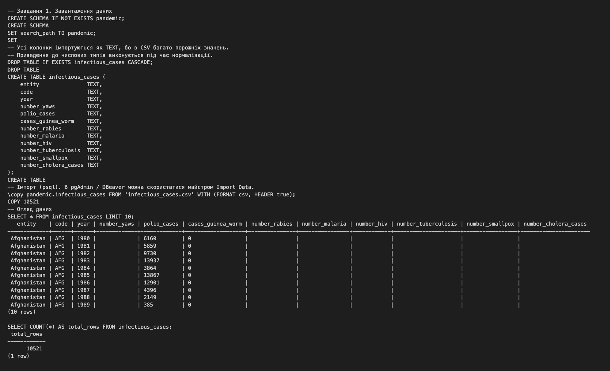
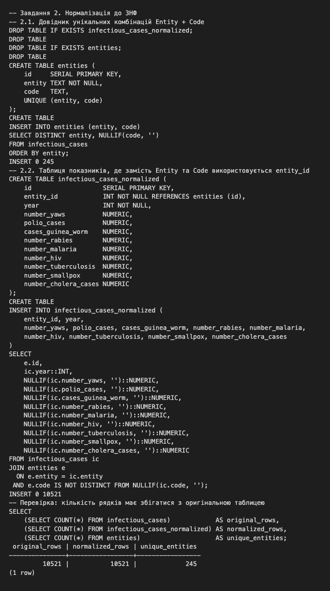
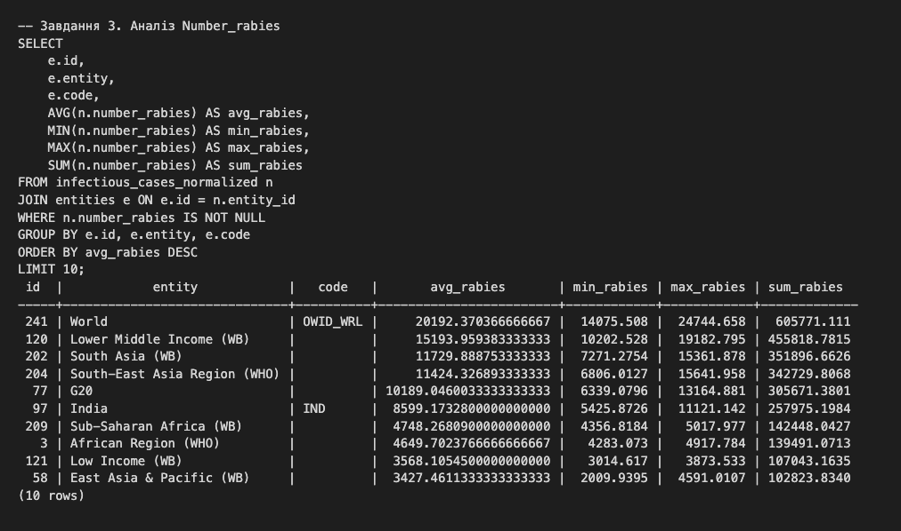
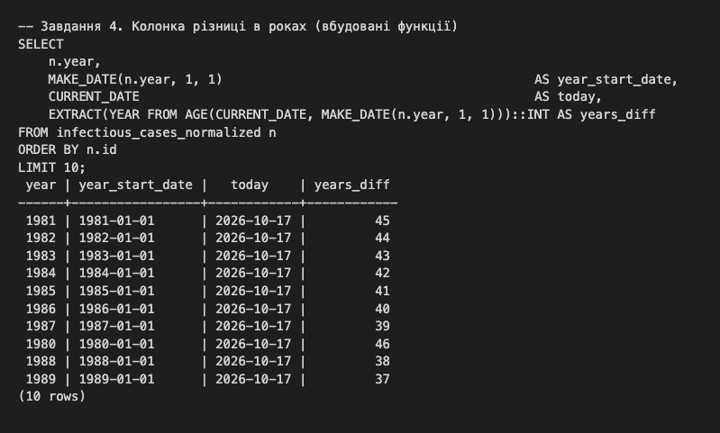
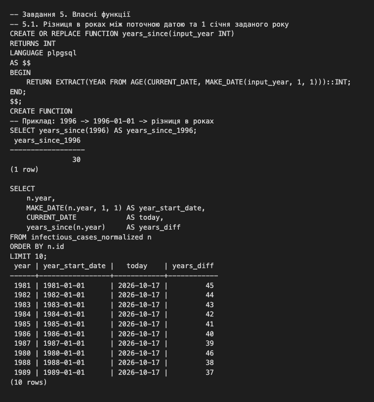
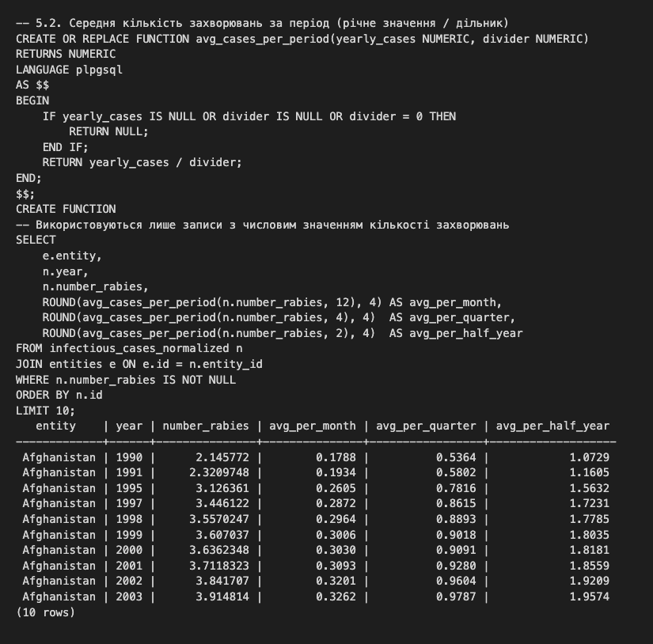

# goit-rdb-fp — Фінальний проєкт з реляційних баз даних

Аналіз датасету `infectious_cases` (статистика інфекційних захворювань за країнами та роками) у PostgreSQL.

Весь SQL-код міститься у файлі [`final_project.sql`](final_project.sql), скриншоти — у папці [`screenshots/`](screenshots/).

## Завдання 1. Завантаження даних
- Створено схему `pandemic` (`CREATE SCHEMA IF NOT EXISTS pandemic;`) і встановлено її схемою за замовчуванням (`SET search_path TO pandemic;`).
- Створено таблицю `infectious_cases`. Усі колонки мають тип `TEXT`, бо в CSV багато порожніх значень.
- Дані імпортовано з `infectious_cases.csv` (майстер Import Data або `\copy`).

## Завдання 2. Нормалізація до 3НФ
- `entities` — унікальні комбінації `Entity` + `Code` (`id`, `entity`, `code`, `UNIQUE (entity, code)`).
- `infectious_cases_normalized` — показники захворювань з `entity_id` (зовнішній ключ на `entities.id`) замість повторюваних `Entity` та `Code`. Порожні рядки перетворено на `NULL`, показники приведено до `NUMERIC`.
- Кількість рядків у нормалізованій таблиці збігається з оригінальною.

## Завдання 3. Аналіз Number_rabies
Для кожного `entity_id` пораховано `AVG`, `MIN`, `MAX` і `SUM` для `number_rabies` (лише непорожні значення). Результат відсортовано за середнім значенням за спаданням, виведено 10 рядків.

## Завдання 4. Різниця в роках
Через вбудовані функції побудовано:
- `MAKE_DATE(year, 1, 1)` — дату 1 січня відповідного року;
- `CURRENT_DATE` — поточну дату;
- `EXTRACT(YEAR FROM AGE(CURRENT_DATE, MAKE_DATE(year, 1, 1)))` — різницю в роках.

## Завдання 5. Власні функції
- `years_since(input_year INT)` — повертає різницю в роках між поточною датою та 1 січня заданого року (наприклад, `years_since(1996)`).
- `avg_cases_per_period(yearly_cases NUMERIC, divider NUMERIC)` — повертає річну кількість захворювань, поділену на дільник (`NULL`, якщо дільник 0). Перевірено з дільниками 12 (місяць), 4 (квартал) і 2 (півріччя) лише на записах із числовим значенням `number_rabies`.

